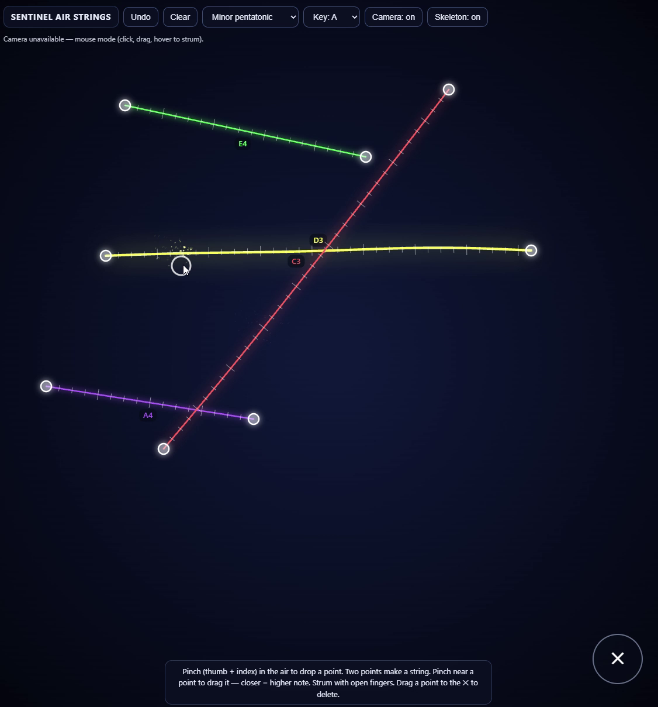

# Sentinel Air Strings

**Play invisible strings in the air.**

Sentinel Air Strings turns your webcam into an augmented-reality instrument. You pinch to hang points in the air, stretch glowing strings between them, and strum those strings with your fingers. Short strings sing high, long strings go low. It runs entirely in the browser: one HTML file, no install, no account.

### ▶ [Try the live demo](https://jameskeithharwood.com/sentinel-air-strings/)

Works in a desktop or phone browser. Allow camera access, turn your sound up, and start pinching.

---

## What it is

Your camera shows you as a mirror image. On top of that live view, the app draws the strings you create, so they look like they are floating in front of you. The camera tracks your hands, and your hands are the controller:

- Pinching places and moves points.
- Your fingertips are the picks that pluck the strings.
- Every string has its own pitch, color, and note name.

## How it works

| Piece | What it does |
|---|---|
| **Hand tracking** | [MediaPipe Hand Landmarker](https://ai.google.dev/edge/mediapipe/solutions/vision/hand_landmarker) finds up to 4 hands and 21 landmarks per hand in every video frame, right in your browser. |
| **Pinch detection** | A pinch is the distance between thumb tip and index tip, measured relative to the size of your hand, with hysteresis so it does not flicker. |
| **Strumming** | Each frame, the app checks whether a fingertip's path crossed a string. Faster crossings play louder. |
| **Pitch** | A string's pitch comes from its on-screen length. Shorter is higher, longer is lower. Pitch updates live as you drag a point. |
| **Sound** | Each pluck is synthesized with the Karplus-Strong plucked-string algorithm using the Web Audio API, with a touch of echo. No audio files are used. |
| **Visuals** | Canvas 2D: glowing strings with overtone wobble, tick marks, spark particles on every pluck, and a hand skeleton overlay. |

The camera image is processed on your device. Nothing from your video is uploaded anywhere. (The hand-tracking library and model are downloaded from public CDNs when the app loads, so you need an internet connection.)

## How to use it

1. Open the page and tap **Start**. Allow camera access when asked, and turn your sound up.
2. Wait a moment for "Hands ready" to appear.
3. **Place a point:** Pinch your thumb and index finger together in the air.
4. **Make a string:** Pinch a second time somewhere else. A string stretches between the two points.
5. **Retune a string:** Pinch near a point to grab it, then drag. Bring the points closer for a higher note, or pull them apart for a lower one. The note name is shown on each string.
6. **Strum:** Keep your fingers open and sweep them across a string. Strum fast for loud, glowing plucks.
7. **Delete a point:** Drag it to the ✕ in the bottom-right corner and release. Its string goes with it.
8. Add as many strings as you like, up to 24 points. Each string plays independently, and they can cross.

### Controls

| Control | What it does |
|---|---|
| **Undo** (or `Z`) | Removes the most recently placed point and its string. |
| **Clear** (or `C`) | Removes everything. |
| **Scale** | Minor pentatonic, major pentatonic, major, blues, or free. The first four snap strings to notes in the scale; free lets pitch slide continuously. |
| **Key** | Sets the root note of the scale. |
| **Camera** | Turns the camera image on or off. The instrument keeps working over a plain background. |
| **Skeleton** | Shows or hides the green hand skeleton overlay. |
| **Hide menu** (or `H`) | Hides all the buttons and the instruction box for a clean, full-screen view. Tap the small ☰ in the top-right corner to bring them back. |

### No camera? Use a mouse

Click to place points, click and drag to move them, and hover across a string to strum.

## Tips

- Use good, even lighting and keep your hands fully in frame.
- Play about an arm's length from the camera so both hands are clearly visible.
- Keep your strumming hand open. If your thumb and index finger drift together, the app reads it as a pinch and may place a stray point.
- A pinched hand does not strum, and an open hand does not place points, so you can use one hand to build and the other to play.

## Running it yourself

It is a single file named `index.html`, with no build step.

- **GitHub Pages:** Upload `index.html` to a repo and enable Pages. It works over https.
- **Locally:** Serve the folder from localhost, for example `python3 -m http.server`, and open `http://localhost:8000`.

Browsers only allow camera access on https pages or localhost, so opening the file directly from your disk will not work.

## Troubleshooting

- **"Camera unavailable":** Check your browser's camera permission for the site, and make sure no other app is using the camera.
- **"Hand tracking failed to load":** The tracking library could not be downloaded. Check your connection and reload. Mouse mode still works.
- **No sound:** Start the app with the Start button (browsers require a tap before playing audio) and check your volume.
- **Choppy tracking:** Close other heavy tabs and apps. A phone or laptop with a modern GPU will track more smoothly.

## Built with

- [MediaPipe Tasks Vision](https://www.npmjs.com/package/@mediapipe/tasks-vision) for hand tracking
- Web Audio API for sound
- Canvas 2D for visuals
- Plain HTML, CSS, and JavaScript

## About

Part of the Sentinel family of projects by James Keith Harwood II, [Sentinel AI Systems](https://www.jameskeithharwood.com). It grew out of the camera and body-tracking ideas in Sentinel Spotter.
